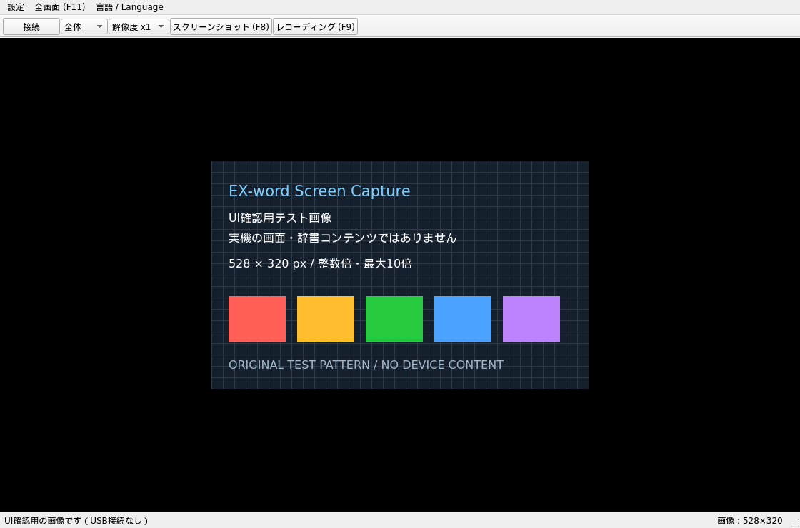

# EX-word Screen Capture

日本語 · [English](README.en.md) · [简体中文](README.zh-CN.md) · [繁體中文](README.zh-TW.md)

CASIO EX-wordの「プロジェクター接続」を利用し、PCで画面の表示・保存・録画を行うソフトウェアです。

バージョン：v1.0.0

※掲載用テストパターン画像を使用しています。

## 主な機能

- PNGスクリーンショット、音声なしのH.264 / MP4録画（標準）。無劣化保存にはFFV1 / MKVを選択できます。
- 受信した実画面解像度を基準とする、x1〜x10の整数倍拡大。
- 全体／上画面／下画面の切替、整数倍を維持した全画面表示。
- 保存先の指定、グレースケール・色反転フィルター。
- 日本語・英語・簡体字中国語・繁体字中国語のUI。

## 対応機種

### 実機動作確認済み

実機で確認した機種・OSと機能です。

- CASIO EX-word XD-N6500（DATAPLUS 7）：Linux（画面表示・静止画保存・録画）
- CASIO EX-word XD-K8700（DATAPLUS 9）：macOS（画面表示・録画）
- CASIO EX-word XD-Y4900（DATAPLUS 10）：Linux（画面表示・静止画保存・録画）、Windows（画面表示）

### 理論上の対応候補（実機動作未確認）

公式資料にプロジェクター接続機能が記載されているシリーズを、対応候補として挙げています。
対象は各シリーズのうち、その機能を備える機種です。上記以外の機種は、本ソフトでの接続・表示を実機確認していません。

- EX-word：XD-Nシリーズ、XD-Kシリーズ、XD-Yシリーズ、XD-SXシリーズ。
- グラフ関数電卓：fx-9860Gシリーズ（GII・GIIIを含む）、fx-9750Gシリーズ。
- カラーグラフ関数電卓：fx-CG10／20／50シリーズ、GRAPH90+ E。

投影機能があるだけでは互換性を保証できません。fx-CG系は `ScreenR(XP)` モードのみが候補です。
根拠と接続条件は[対応機種の資料](docs/COMPATIBILITY.md)を参照してください。

## 利用環境

- PC用GUI：Windows x64、macOS arm64、Linux x86_64。OS側の条件は[セットアップ](docs/SETUP.md)を参照してください。
- Linux CLI：画面表示なしの保存・録画用。[導入・操作](docs/SETUP.md#headless-cli--軽量環境向けcli)。
- Brainux：Brain上で表示する別アプリ。[PC版との違い・導入方法](docs/BRAINUX.md)。

### 推奨スペックの目安

528×432・10 fps録画を基準とする計算上の目安です。実測の最低要件や性能保証ではありません。

| 用途 | CPUの選定目安 | RAM | 保存先 |
| --- | --- | --- | --- |
| 表示・PNG保存・x1〜x2録画 | 64-bit、2コア以上 | 4 GiB以上 | SSD推奨 |
| x10録画（5280×4320） | 64-bit、4コア以上 | 8 GiB以上 | SSD、十分な空き容量 |

OS側の要件を優先してください。専用GPUは必須ではありません。負荷は解像度と画面内容によって変わります。
詳細な[計算根拠](docs/RESOURCE_ESTIMATES.md)は別資料にまとめています。

## 導入

### 実行ファイルを使う

[Releases](https://github.com/ToTo-40417/exword-screen-capture/releases)から、自分のOSに合ったGUI版をダウンロードします。

- **Windows x64**：`EXwordScreenCapture.exe` を起動します。初回接続前に、対象USBへの**WinUSBドライバーの割り当て**が必要です。[Windowsの接続準備](docs/WINDOWS_USB.md)に沿って設定してください。
- **macOS**：ZIPを展開して `.app` を起動します。未公証アプリの初回実行許可が必要な場合があります。
- **Linux**：ZIPを展開し、フォルダ内の `EXwordScreenCapture` を起動します。フォルダごと保持してください。USBアクセス権の設定が必要な場合があります。

GUI版はPython・Qt・libusb・録画用FFmpegを同梱します。
ただし、libusbの同梱はWindowsのUSBドライバー設定を代替しません。
ドライバー変更はCASIOの転送ソフトにも影響するため、対象機器と元の設定を確認してから行ってください。
OS側の条件は[セットアップ](docs/SETUP.md)を参照してください。

### ソースから起動する

Python環境・依存ライブラリの導入とビルド手順は[セットアップ](docs/SETUP.md)を参照してください。

## GUIの使い方

### 接続する

1. 電子辞書をUSBでPCに接続し、PCアプリの「接続」をクリックします。
2. 確認画面で「接続する」をクリックします。「待機中」と表示されます。
3. 電子辞書で「プロジェクター接続」を選びます。PCのボタンが「切断」に変わったら接続完了です。

本体側が接続待ちを終了した場合は、PCを待機状態にしたまま「プロジェクター接続」を選び直してください。
Windowsで待機が続く場合は、[ドライバーの確認](docs/WINDOWS_USB.md#接続できない場合)を行ってください。

受信を止めるときは、PCアプリの「切断」をクリックします。

### 撮影・録画する

「設定」で録画形式と録画倍率（x1〜x10）を選べます。初期値はH.264 / MP4・x1です。
表示・PNGの倍率とは独立しています。高倍率の動画は再生環境や処理能力によって再生できない場合があります。

| やりたいこと | PCアプリでの操作 | キー |
| --- | --- | --- |
| 画像を保存 | 「スクリーンショット (F8)」をクリック | F8 |
| 録画を開始／停止 | 「レコーディング (F9)」をクリック | F9 |
| 全画面に切替 | 「全画面 (F11)」をクリック | F11 |
| 全画面を解除 | Escを押す | Esc |

初期の保存先は `Pictures/EX-word Captures` です。「設定」から変更できます。
毎回、日時付きの別ファイルを作成し、既存のファイルは上書きしません。

### 表示と設定を変える

- **表示範囲**：「全体」は上下を含む受信画面全体です。対応する上下画面では「上画面」「下画面」も選べます。
- **倍率**：「解像度 x1」からx1〜x10を選びます。表示とPNG保存の倍率が変わります。入りきらない部分はスクロールできます。
- **全画面**：1〜10倍のうち、画面に収まる最大の倍率で中央表示します。黒い余白ができる場合があります。元画像より画面が小さい場合は一部が切れます。保存倍率は変わりません。
- **フィルター**：「設定」で「なし」「グレースケール」「色反転」を選べます。表示・保存・録画に共通で適用します。
- **言語**：全画面の隣の「言語 / Language」で変更できます。

言語・保存先・倍率・フィルターは次回起動時にも保持します。

## 注意事項

- 通常のUSB通信モードではなく「プロジェクター接続」を使います。他のUSB転送ソフトと同時に接続せず、本体は1台だけ接続してください。
- 自作アプリ（追加コンテンツ）を使用中は、画面をキャプチャできない場合があります。
- 録画は10 fps・音声なしです。画像が更新されない間も直前の画面を記録します。10 fpsは本体の送信頻度を保証する値ではありません。
- エンコードが追いつかない場合はエラーで停止します。
- キャプチャした内容の利用・公開に必要な権利は、利用者が確認してください。

## ライセンス・技術資料

独自ソースは[MIT License](LICENSE)です。依存ライブラリのライセンスはそれぞれの作者に帰属します。
GUI版はQt/PySide/Shiboken（LGPL-3.0）、libusb（LGPL-2.1-or-later）、FFmpeg/libx264（GPL-2.0-or-later）を使用し、
対応ソース・権利表示を配布パッケージに同梱します。[差し替え手順](docs/LIBRARY_REPLACEMENT.md)も参照できます。
Cahuteの公開仕様を参照した独立実装であり、Cahuteのコード、CASIOの辞書・ファームウェアは含みません。
本ソフトウェアはCASIOの公式製品ではありません。

- [導入・パッケージ作成](docs/SETUP.md)
- [通信仕様と安全性](docs/PROTOCOL.md)
- [ライセンスとバイナリ配布時の確認事項](docs/LICENSING.md)
- [第三者ライセンス表記](THIRD_PARTY_NOTICES.md)
